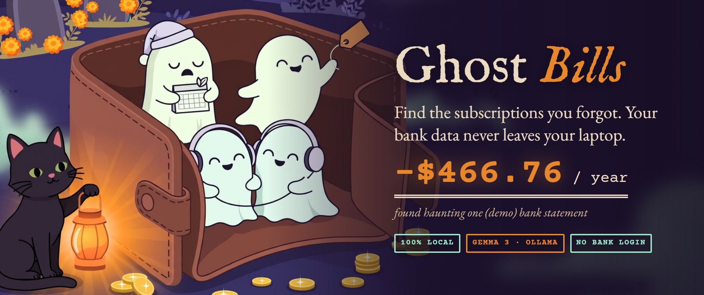
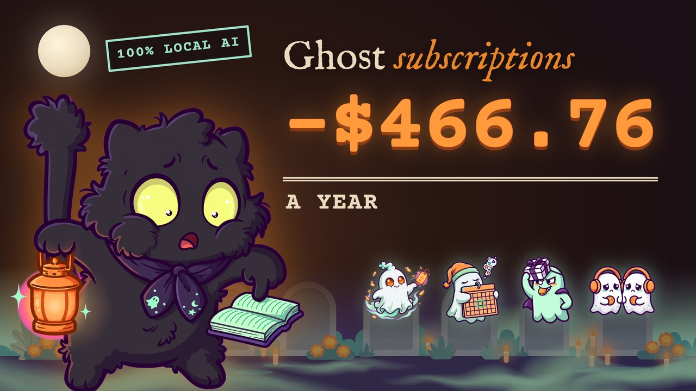
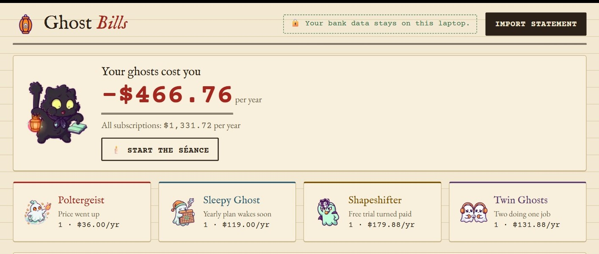
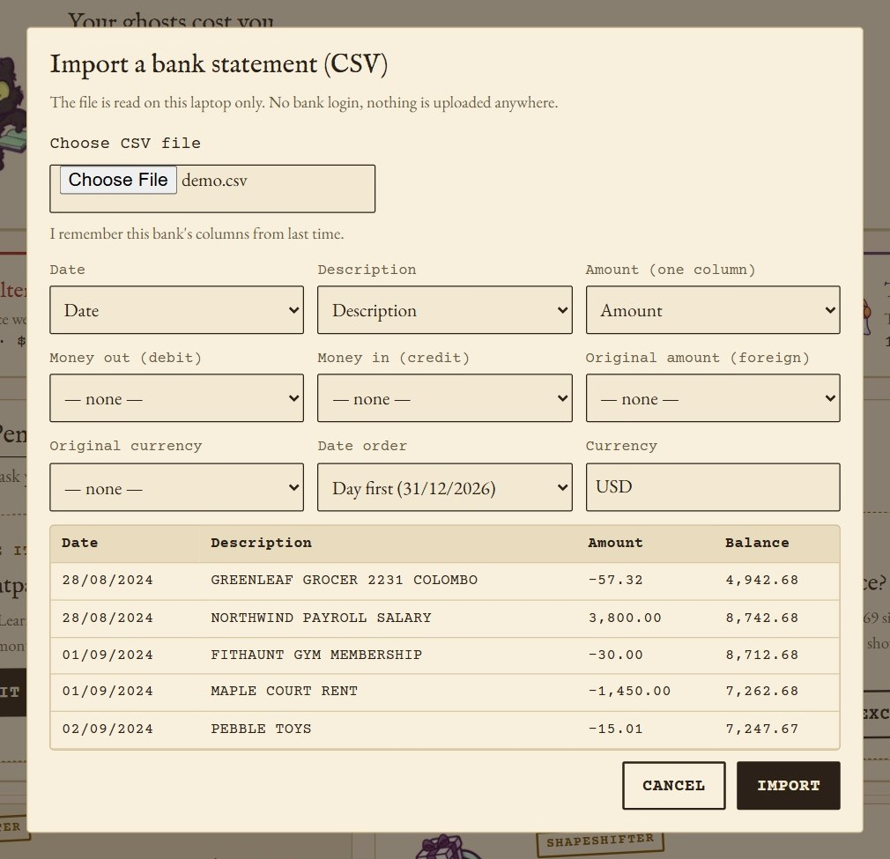
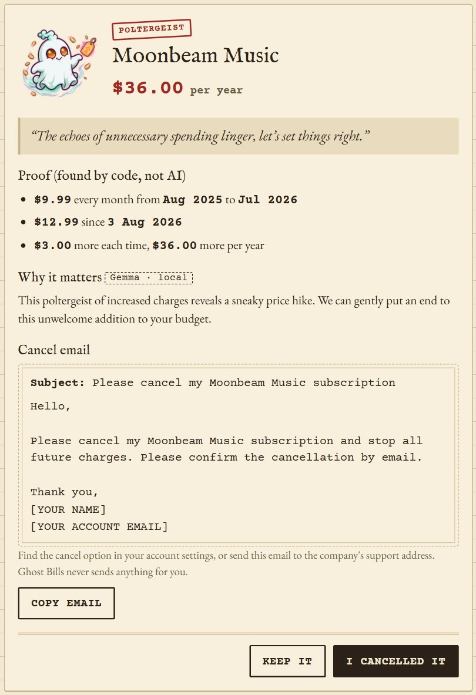
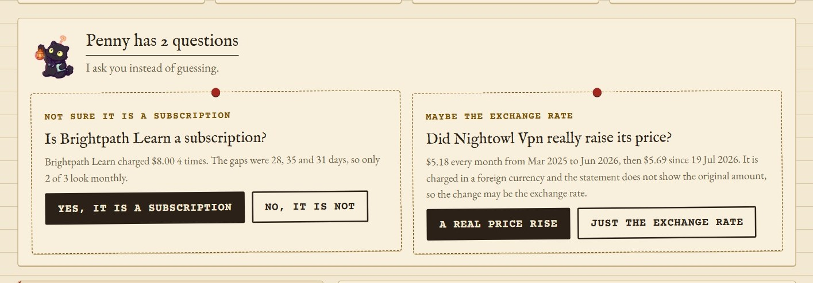
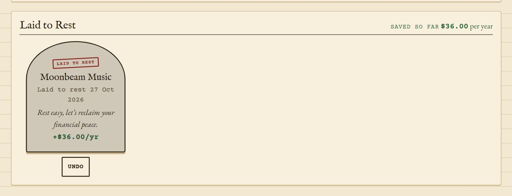
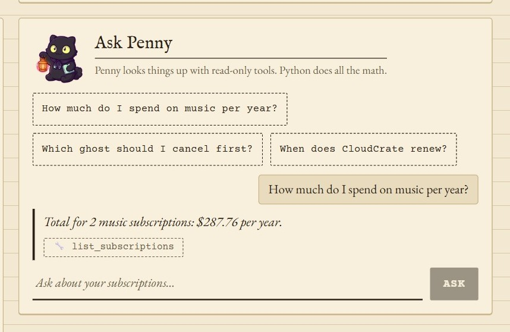
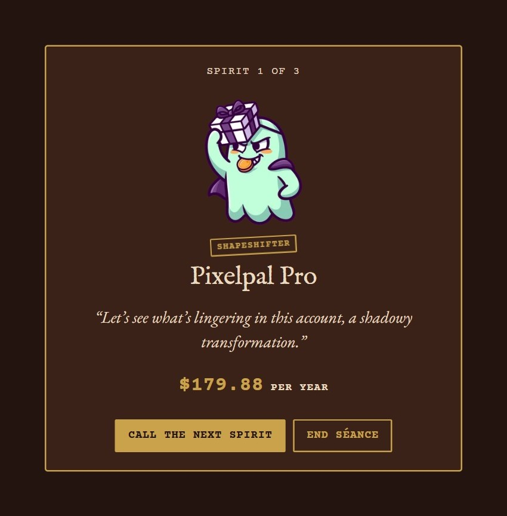

# Ghost Bills 👻💸



**Forgotten subscriptions are ghosts in your bank account.** Ghost Bills reads your
bank statement (CSV), finds the ghosts, shows what they cost you per year, and
writes a polite cancel email. **Your bank data never leaves your laptop.**
Gemma runs locally in Ollama, and the app works with Wi-Fi off.

> **AI explains, code finds, you decide.**
> Plain Python finds every ghost and does every sum. Gemma only writes the
> friendly words. You decide what to keep and what to cancel.

## Watch the 3½-minute tour

[](https://youtu.be/uTmU83j69yw)

From importing a bank CSV to laying a ghost to rest, in the real app.

## The four ghosts


| Ghost | What it is | Demo example |
| --- | --- | --- |
| 💥 **Poltergeist** | The price went up without you noticing | Moonbeam Music: $9.99 → $12.99 |
| 😴 **Sleepy Ghost** | A yearly plan that charges again soon | CloudCrate renews in 9 days for $119.00 |
| 🎭 **Shapeshifter** | A free trial that turned into a paid plan | PixelPal Pro: $0.00, now $14.99/month |
| 👯 **Twin Ghosts** | Two subscriptions that do the same job | Moonbeam Music + EchoTunes, both music |

On the demo statement the ghosts cost **$466.76 per year**.



## Quick start (3 steps)

You need [Python 3.12 + uv](https://docs.astral.sh/uv/), [Node.js 20+](https://nodejs.org)
and [Ollama](https://ollama.com).

```bash
ollama pull gemma3:4b          # 1. get the model (once)
uv sync                        # 2. install
uv run python -m scripts.dev   # 3. load demo data, start everything
```

Open <http://localhost:5173>. (`make dev` does step 3 too.)

Without Ollama the app still finds every ghost and does all the money math. It
uses simple template text instead of Gemma's words and shows the fix command.

## How it works, in five steps

**1. Import your bank's CSV.** Ghost Bills guesses the date, description and amount
columns. You check them, and it remembers that bank's layout.



**2. Code finds the ghosts.** Plain Python looks for repeating charges and runs the
four rules. Normal shopping, rent and tiny price changes are not flagged.

**3. Check the proof.** Every ghost shows the real charges from your statement, found
by code, not AI. Gemma explains why it matters, and writes a short cancel email.



**4. Answer Penny.** When a rule isn't sure, Penny asks instead of guessing, and she
remembers your answer.



**5. You decide.** Copy the email and send it yourself (the app never sends anything).
Then click "I cancelled it", and the ghost is laid to rest.



**Extras:** see the charges coming in the next 30 days, ask Penny questions (the maths
is done by code), or start the séance to meet your ghosts one by one.

<p>
  
  
</p>

Other commands: `make test` (or `uv run pytest -q`), `make seed` (reset the demo data).
Settings: `OLLAMA_MODEL` (default `gemma3:4b`), `DEMO_TODAY` (default `2026-10-27`),
`GHOST_API_PORT` (default `8765`).

## Your own statement

Click **Import statement** and choose a CSV export from your bank. No bank login and no bank API.

- Commas, semicolons or tabs. Title rows above the table are skipped.
- One **Amount** column (signed or all positive), or **Debit** / **Credit** columns.
- Dates like `2026-08-03`, `03/08/2026` or `08/03/2026`. If every date could be read
  both ways, Penny asks you.
- `$1,234.56`, `1.234,56`, `(12.00)` and `12.00-` all work. Money is kept as integer
  cents, parsed with `Decimal`, never floats.
- A foreign amount (like `EUR 4.99` in the description, or an "Original amount"
  column) is used to compare prices in the original currency.

You can check and change every guessed column before importing. Your choice is remembered for that bank.

## How we decide

All numbers live in [backend/detect/config.py](backend/detect/config.py) and are
shown in the app under "How we decide".

1. **Find repeating charges.** Group by a cleaned merchant name. You need 3 charges
   (2 for yearly). Gaps must be weekly (6–8 days), monthly (27–33) or yearly
   (355–375). At least 70% of gaps must fit, and prices must stay within ±10%,
   or make one clear step up or down. Rent, mortgage, loans, power, water and
   insurance are skipped.
2. **Run 4 rules.**
   - Poltergeist: newest price ≥ 5% **and** ≥ $0.50 above the old price.
   - Sleepy Ghost: a yearly plan renewing within 30 days.
   - Shapeshifter: a first charge of $0–$1 (or ≤ 10% of the later price) in the last 90 days, then 2 full-price charges.
   - Twin Ghosts: two active subscriptions in the same category. Only built-in or
     user-confirmed categories count, never an AI guess.
3. **Ask instead of guessing.** If only 50–70% of gaps fit, the day/month order is
   unclear, or a price change might be the exchange rate, Penny shows a question
   card. Your answer is saved, so you are never asked twice.

**Exchange rates.** A subscription billed in another currency costs a little more or less every
month. Ghost Bills compares the original currency when the statement shows it.
When it does not, a foreign charge needs a 15% rise to count, and smaller changes become a
question. Ghost Bills never downloads or guesses exchange rates.

## What Gemma does (and cannot do)

- Gemma gets **one ghost's facts** inside `<data>` tags. It never sees the full statement or account numbers.
- It returns JSON (Ollama structured output): a display name, a séance line, a
  gravestone epitaph, a short explanation and a cancel email.
- [backend/llm/grounding.py](backend/llm/grounding.py) checks every answer. Each
  amount and date must be in the facts. Links, phone numbers and email addresses are
  rejected, and word limits apply. After two failed tries, fixed template text is
  used and marked "template text".
- **Ask Penny** is a small LangGraph agent with 5 **read-only** tools. Python does
  every sum. The answer may only use numbers that a tool returned. No tool can send,
  change or open anything.

## Privacy

Everything runs on your laptop: FastAPI, SQLite (`ghost_bills.db`), Ollama and the
web page. Nothing is uploaded. The app never sends email, never opens links and
never contacts any company. Fonts and pictures are bundled, so it works offline.

## Auth0 setup (optional: only for "Send with Gmail")

Without Auth0, Ghost Bills runs fully local and offline. Set it up only if you
want Penny to send an approved cancel email from your own Gmail. The details and
sources are in [docs/auth0-notes.md](docs/auth0-notes.md).

> **Plan note:** login, Penny's read-only token and Token Vault work on the
> Free plan. The phone approval (CIBA, "Lock 3") needs a paid plan with the
> **AI Agents add-on**, or Enterprise.

Auth0's On-Behalf-Of exchange needs one API per hop, and each agent is a
**Custom API Client** tied to the API whose token it receives:

```
user login token (aud: /login) --Penny--> token (aud: /ledger, read:ghosts)
                                --Courier--> token (aud: /courier, send:cancel_email)
```

Do these steps in the Auth0 Dashboard, in order:

1. **APIs** (Applications > APIs > Create API), three of them:
   - `Ghost Bills Login`, identifier `https://ghost-bills.local/login`
   - `Ghost Bills Ledger`, identifier `https://ghost-bills.local/ledger`, permission `read:ghosts`
   - `Ghost Bills Courier`, identifier `https://ghost-bills.local/courier`, permission `send:cancel_email`
   - On `Ghost Bills Ledger` and `Ghost Bills Courier`: Settings > **Allow Offline
     Access** off, and a short token expiration (300 seconds). `Ghost Bills Login`
     can keep the default expiration.
2. **Regular Web Application** `Ghost Bills Web` (Applications > Create Application):
   - Allowed Callback URLs: `http://localhost:5173/auth/callback`
   - Allowed Logout URLs: `http://localhost:5173`
   - Allowed Web Origins: `http://localhost:5173`
   - Copy its Client ID and Secret to `AUTH0_CLIENT_ID` / `AUTH0_CLIENT_SECRET`.
3. **Penny** (Applications > APIs > `Ghost Bills Login` > Add Application, which
   creates a Custom API Client with the same identifier):
   - Name it `Penny`. Under API Access, edit `Ghost Bills Ledger` and grant
     **User-Delegated Access** with `read:ghosts`.
   - Under **Token Exchange**, turn on **On-Behalf-Of Token Exchange** and save.
   - Copy its credentials to `PENNY_CLIENT_ID` / `PENNY_CLIENT_SECRET`.
4. **Courier** (Applications > APIs > `Ghost Bills Ledger` > Add Application):
   - Name it `Courier`. Under API Access, edit `Ghost Bills Courier` and grant
     **User-Delegated Access** with `send:cancel_email`.
   - Turn on **On-Behalf-Of Token Exchange**.
   - Under Advanced Settings > Grant Types, turn on **Token Vault**.
   - Turn on **Client Initiated Backchannel Authentication (CIBA)** if it's
     offered here. If not, create a Regular Web App `Ghost Bills Approvals`
     with the CIBA grant and use its credentials as `CIBA_CLIENT_ID` / `CIBA_CLIENT_SECRET`.
   - Copy its credentials to `COURIER_CLIENT_ID` / `COURIER_CLIENT_SECRET`.
5. **Google with Token Vault** (Authentication > Social > Google / Gmail):
   - In Google Cloud: create an OAuth client (Web), add Auth0's callback
     `https://YOUR_DOMAIN/login/callback`, enable the **Gmail API**, keep the
     consent screen in **Testing**, and add your Gmail as a **test user**.
   - In Auth0: paste the Google client ID and secret. Under Permissions, add
     `https://www.googleapis.com/auth/gmail.send`. Turn on **Offline Access**
     and **Token Vault** (Connected Accounts / "Use for Token Vault").
   - Enable the connection for `Ghost Bills Web`.
6. **Phone approval (CIBA + Guardian)**:
   - Security > Multi-factor Auth: enable **Push Notification using Auth0 Guardian**.
   - On the approval client (Courier or `Ghost Bills Approvals`), set the CIBA
     notification channel to **push**.
   - Install the **Auth0 Guardian** app on your phone and enroll your user
     (log in once with MFA, or enroll under User Management > Users).
7. Copy `.env.example` to `.env`, fill in the values, and restart with
   `uv run python -m scripts.dev`. **Log in** appears in the header.

## Limits

- CSV only (no PDF, no bank connection).
- One currency per file.
- No auto-cancel: you send the email or use the company's settings yourself.
- Detection is rule-based on purpose. Odd billing patterns may need your answer on a question card.

## Credits

The mascots and pictures were made with an image API (Meta Muse Image) and are only
decoration. The app itself runs only on open models (Gemma, via Ollama). All merchant
names in the demo are invented.

## Project layout

```
backend/
  importer/   CSV reading, column guessing, bank profiles
  detect/     series, 4 ghost rules, questions, thresholds
  llm/        Ollama client, Gemma enrich, grounding check
  agent/      Ask Penny (LangGraph + read-only tools)
  app.py      FastAPI routes
  seed_demo.py  fake 26-month statement with planted ghosts
frontend/     Vite + React + TypeScript, plain CSS
tests/        pytest: rules, near misses, money and date edge cases, grounding, agent
scripts/      dev runner, asset generator, mascot sync
```
